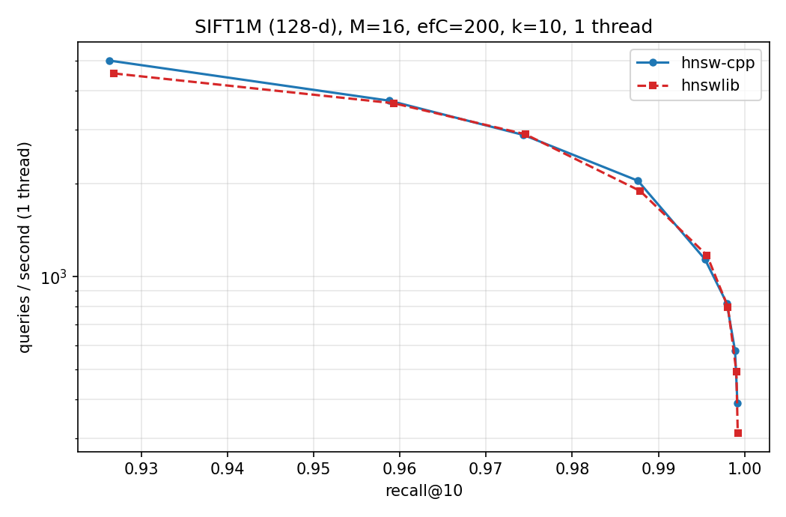
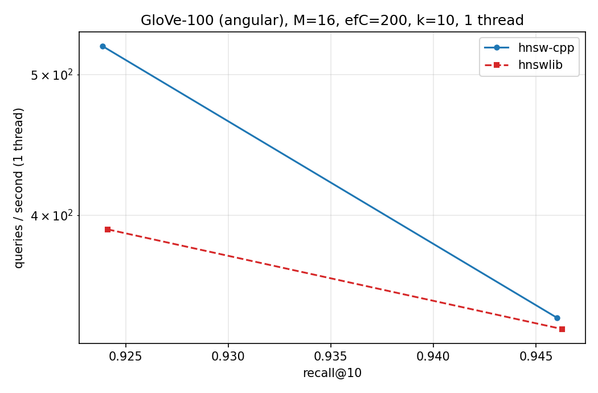

# HNSW in C++17

[](https://github.com/sindhuja-tiwari/Hierarchical-Navigable-Small-World/actions/workflows/ci.yml)

A from-scratch **HNSW** (Hierarchical Navigable Small World) approximate nearest-neighbour index,
built from the original paper (Malkov & Yashunin). Header-only, no dependencies, with a
multithreaded build, lock-free queries, SIMD distance kernels (AVX2 on x86, NEON on Apple Silicon),
a correctness suite that also runs under ASan / UBSan / TSan, and a benchmark harness that measures
**recall@10 vs queries-per-second** against [hnswlib](https://github.com/nmslib/hnswlib) on the same
data and ground truth. CI builds and tests on Linux (x86-64) and macOS (Apple Silicon).



```
include/hnsw.h        the index (~600 lines)
include/dataset.h     fvecs/ivecs IO, synthetic data, parallel brute-force ground truth
src/bench.cpp         recall@k vs QPS sweep -> CSV
tests/test_hnsw.cpp   unit/property tests
scripts/              dataset download, hnswlib baseline, plotting, result summary, run_all.sh
results/              CSVs, logs and plots produced by the benchmarks
```

## Quick start

Needs a C++17 compiler (g++ or clang) and `make`. Linux, macOS (Intel or Apple Silicon) or WSL.
On macOS run `xcode-select --install` once.

```bash
make            # builds build/bench and build/test_hnsw  (-O3, native SIMD)
make test       # correctness suite
make asan tsan  # same suite under AddressSanitizer+UBSan / ThreadSanitizer
make scalar     # bench with SIMD disabled (build/bench_scalar), to separate algorithm from kernel
```

```cpp
#include "hnsw.h"

hnsw::Index::Params p;
p.dim = 128; p.max_elements = 1'000'000; p.M = 16; p.ef_construction = 200;
hnsw::Index index(p);

index.add_batch(vectors, n, /*threads=*/8);             // row-major float*, label = row number
auto hits = index.search(query, /*k=*/10, /*ef=*/100);  // vector<pair<squared_dist, label>>, ascending
```

`ef` is the recall/speed knob: larger means higher recall and slower queries. For cosine / angular
similarity, L2-normalise vectors first (the nearest-neighbour ordering is identical).

## Benchmarks

### Run on the standard datasets (SIFT1M, GloVe-100)

```bash
python3 -m venv .venv && source .venv/bin/activate
pip install numpy matplotlib h5py hnswlib
scripts/run_all.sh 8        # 8 = number of threads
```

This builds, runs the tests, downloads both datasets from ann-benchmarks (ground truth included),
benchmarks hnsw-cpp and hnswlib with identical parameters (M=16, efC=200, k=10), writes CSVs, logs
and plots to `results/`, and prints a summary table. Query throughput is measured one query at a
time on a single thread (the ann-benchmarks convention); multi-thread throughput is also recorded
(`qps_mt` column). Manual use of the individual tools:

```bash
build/bench --base data/sift_base.fvecs --query data/sift_query.fvecs --gt data/sift_gt.ivecs \
            --metric l2 --M 16 --efc 200 --threads 8 --compare-build --out results/sift_cpp.csv
python3 scripts/bench_hnswlib.py --base data/sift_base.fvecs --query data/sift_query.fvecs \
            --gt data/sift_gt.ivecs --M 16 --efc 200 --threads 8 --out results/sift_hnswlib.csv
python3 scripts/plot.py results/sift_cpp.csv results/sift_hnswlib.csv -o results/sift.png
```

### Results

SIFT1M (1,000,000 x 128-d, 10,000 queries), M=16, efC=200, k=10, single-threaded queries, on a
MacBook Air with an Intel Core i5-8210Y (2 cores / 4 threads, AVX2). Both implementations use
identical parameters and the same ground truth.

| target recall@10 | hnsw-cpp (q/s) | hnswlib 0.8.0 (q/s) | ratio |
|---|---|---|---|
| 0.90 | 6,285 | 5,637 | 1.11x |
| 0.95 | 4,025 | 3,882 | 1.04x |
| 0.99 | 1,708 | 1,661 | 1.03x |

At equal `ef` the two graphs reach the same recall: the largest gap across the sweep is 0.003
(e.g. 0.9263 vs 0.9268 at ef=40, 0.9954 vs 0.9956 at ef=200). QPS is interpolated at fixed recall.
Build with 8 worker threads on the 2-core / 4-thread CPU: 427 s (hnsw-cpp) vs 414 s (hnswlib);
hnsw-cpp single-thread build is 923 s, a 2.2x speedup. The 1M-point parallel build has 0
unreachable nodes.


Caveats: one low-power laptop, so absolute numbers and timing noise differ from a server; the
timing harnesses differ (C++ per-query loop vs hnswlib's batched call from Python). Multi-thread
query throughput is not reported: hnsw-cpp currently reaches 65-90% of hnswlib's multi-thread QPS
on this machine and the cause is under investigation.

### GloVe-100 (angular)

GloVe-100 (1,183,514 x 100-d, 10,000 queries, vectors L2-normalised so L2 ordering equals angular
ordering), M=16, efC=200, k=10, single-threaded queries, same machine, parameters and ground truth
for both implementations.

| ef | recall@10 hnsw-cpp | recall@10 hnswlib | q/s hnsw-cpp | q/s hnswlib |
|---|---|---|---|---|
| 40 | 0.7004 | 0.7049 | 3,424 | 4,289 |
| 120 | 0.8240 | 0.8263 | 1,867 | 1,807 |
| 300 | 0.8945 | 0.8941 | 833 | 681 |
| 500 | 0.9239 | 0.9241 | 523 | 391 |
| 800 | 0.9460 | 0.9463 | 340 | 334 |

Recall: the two graphs agree within 0.006 at every `ef` (hnswlib slightly higher at ef <= 40) and
within 0.0004 for ef >= 200. The sweep tops out at 0.946 recall@10 for both libraries (ef=800), so
**the 0.95 and 0.99 recall points were not reached** and are not reported.

Throughput: at the one recall level inside the sweep that both libraries bracket, 0.90 recall@10,
hnsw-cpp measured 764 q/s against hnswlib's 610 q/s (1.25x, interpolated). The run was noisy
(throughput is not monotonic in `ef` for hnsw-cpp), and hnsw-cpp is slower than hnswlib at low
`ef` here, so treat GloVe throughput as inconclusive rather than as a speedup; the recall result
is the reliable comparison. Build with 8 worker threads on the 2-core / 4-thread CPU: 572 s
(hnsw-cpp) vs 468 s (hnswlib); hnsw-cpp single-thread build is 1,340 s, a 2.3x speedup. The
parallel build has 0 unreachable nodes.



Raw sweeps: [SIFT1M hnsw-cpp](results/sift_cpp.csv), [SIFT1M hnswlib](results/sift_hnswlib.csv),
[GloVe hnsw-cpp](results/glove_cpp.csv), [GloVe hnswlib](results/glove_hnswlib.csv). Run logs are
in `results/`.

## Design notes

**Structure.** Each point gets a max layer `floor(-ln(U) / ln M)`. Layer 0 holds every point with up
to `2M` links; layers >= 1 hold exponentially fewer points with up to `M` links. The level is a pure
function of `(seed, internal id)` (splitmix64), so there is no shared RNG to contend on.

**Search (paper Alg. 5).** Greedy 1-NN descent from the entry point through the upper layers, then a
best-first search on layer 0 that keeps the `ef` closest elements.

**Neighbour selection (Alg. 4).** The heuristic keeps a candidate only if it is closer to the new
point than to every neighbour already kept. That spreads edges across directions instead of taking
the M nearest (which all sit in one cluster) and keeps clustered data navigable. The same heuristic
shrinks a neighbour's list when a reverse edge overflows it.

**Memory layout.** Vectors are one contiguous array. Layer-0 links are a flat `[count, ids...]`
block per node (no pointer chasing); upper layers are per-node vectors since few nodes have them.
Neighbour vectors are software-prefetched before the distance loop, and the visited set resets in
O(1) with an epoch counter in a `thread_local` array.

**Concurrency.**
- One mutex per node guards that node's neighbour lists. A thread holds at most one node lock at a
  time, so lock-order deadlock cannot happen by construction.
- A global mutex is taken only by an insert that will raise the top layer (rare).
- A node's vector and level are written before it becomes reachable: it links itself first, then its
  neighbours link back. Queries after the build take no locks.
- The test suite is clean under ThreadSanitizer, AddressSanitizer and UBSan.

**Concurrent inserts can orphan nodes.** Two inserts running at the same moment cannot see each
other, so one can be pruned out of every neighbour list and end up (with anything only reachable
through it) with no path from the entry point. In an 8-thread build of 20k points this affected
0.1-0.5% of nodes (serial builds: about 0-0.02%), growing with thread count. It is an algorithmic
effect, not a data race: TSan is clean, and running 8 threads with every `add()` behind one big lock
reproduces the serial result. `repair_connectivity()` runs at the end of `add_batch`: for each orphan
it finds the nearest reachable nodes and adds an edge from the first one that can spare a slot
without orphaning anyone else (target in-degree > 1). After repair the parallel builds I tested had 0
unreachable nodes and recall within about 0.5% of serial.

**Exact duplicate vectors.** A copy of the point being inserted is at distance 0, so the
heuristic would keep every copy (they sort first and prune nothing) until the list is full, and
each group of copies would become an island. With 50 vectors x 100 copies this left 98% of
nodes unreachable. Copies now get at most a quarter of a node's slots up front, never prune
other candidates, and only top up slots the heuristic leaves free; which copies a node keeps is
hashed so newer copies still get in-edges. Data without exact duplicates builds the same graph
as before. `add_batch` returns the number of nodes still unreachable after repair (0 in every
test).

## Limitations and next steps

- L2 only (cosine via normalisation). No inner-product metric, deletion, update or persistence.
- Fixed capacity (`max_elements`), no resizing.
- Parallel builds are not bit-reproducible (internal ids follow thread arrival order).
- Distance kernels: AVX2+FMA, NEON, or portable scalar; no AVX-512 path.
- Ideas with measurable payoffs: `keepPrunedConnections`, int8 / scalar quantisation (memory vs
  recall), `save()` / `load()`, and a profile-guided look at the remaining gap to hnswlib.

## License

MIT, see [LICENSE](LICENSE).
